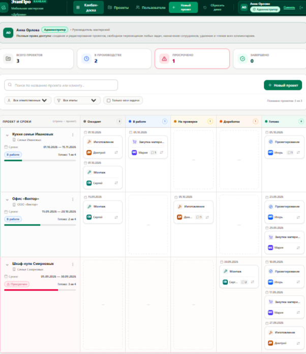

# «ЭтапПро» — Канбан производственных проектов мебельной мастерской «Дубрава»


**«ЭтапПро»** — специализированная веб-система оперативного управления производством для мебельной мастерской индивидуального изготовления «Дубрава». Приложение реализовано в виде интерактивной матрицы-доски, позволяющей в реальном времени отслеживать движение заказов по этапам, контролировать сроки, фиксировать историю операций и обеспечивать строгое разграничение ролей между сотрудниками цехов и руководством.



Работает полностью автономно в браузере: данные сохраняются в `localStorage`, внешние базы данных и серверная часть не требуются.

---

## 📌 Решаемые производственные задачи

В мебельном производстве позаказного типа каждый проект уникален, но проходит одинаковый строгий технологический маршрут. Традиционные доски (Trello, обычный Kanban) часто вызывают хаос, когда карточки смешиваются или теряется привязка к конкретному заказу.

**«ЭтапПро» решает ключевые проблемы мебельного цеха:**

1. **Матричная визуализация проекта и этапов (Строка = Проект):**
   - Каждый заказ представлен отдельной горизонтальной строкой со своим клиентом и дедлайном.
   - Внутри каждого проекта всегда ведутся **4 фиксированные технологические задачи**:
     1. `Проектирование` (конструкторская документация, замеры, 3D-модели).
     2. `Закупка материалов` (плиты ЛДСП/МДФ, массив, фурнитура, кромка, фасады).
     3. `Изготовление` (раскрой, присадка, фрезеровка, сборка корпусов, покраска).
     4. `Монтаж` (доставка, установка у клиента, подгонка по месту, сдача объекта).
   - Задачи размещаются в 5 фиксированных производственных колонках: **«Ожидает»**, **«В работе»**, **«На проверке»**, **«Доработка»**, **«Готово»**.

2. **Предотвращение срывов дедлайнов (Контроль сроков):**
   - Автоматический расчет остатка дней до даты завершения относительно системной даты.
   - **«Просрочен»**: если желаемый срок прошел, а не все 4 задачи завершены (строка подсвечивается красной сигнальной полосой и пульсирующим бейджем).
   - **«Срок близко»**: предупреждение за 3 дня и менее до дедлайна (желтый бейдж).
   - **«Завершён»**: проект отмечается как выполненный только при переходе всех 4 задач в этап «Готово».
   - Счетчик прогресса: наглядный индикатор выполнения (`3 из 4 задач`).

3. **Аудит технологических операций и история переносов:**
   - Над каждой карточкой отображается дата последнего перемещения на текущий этап (`ДД.ММ.ГГГГ`).
   - При каждом переносе (drag-and-drop или через интерфейс) в карточке фиксируется запись: кто автор, когда перенёс, из какого этапа в какой.

4. **Защита конфиденциальности и разграничение зон ответственности:**
   - Рабочие заметки мастера цеха и снабженца не видны посторонним.
   - Сотрудник не может случайно или намеренно передвинуть карточку чужого цеха.

---

## 👥 Роли и пользователи

В системе реализована программная проверка прав доступа при каждом действии (на уровне логики, а не только скрытием кнопок в интерфейсе).

### Матрица прав доступа:

| Возможность | Администратор | Ответственный | Наблюдатель |
| :--- | :---: | :---: | :---: |
| Просмотр доски и статусов всех проектов | ✅ | ✅ | ✅ |
| Перемещение своих карточек | ✅ | ✅ (только своих) | ❌ |
| Перемещение чужих карточек | ✅ | ❌ | ❌ |
| Рабочие комментарии к своим задачам | ✅ | ✅ | ❌ |
| Просмотр чужих внутренних комментариев | ✅ | ❌ (скрыты) | ❌ (скрыты) |
| Удаление комментариев | Любые | Только свои | ❌ |
| Создание / редактирование / архив проектов | ✅ | ❌ | ❌ |
| Управление пользователями и смена ролей | ✅ | ❌ | ❌ |

---

### Демонстрационные пользователи (вход в 1 клик, без пароля):

1. **Анна Орлова — Администратор (Руководитель мастерской)**
   - Имеет неограниченный доступ: координирует все 4 этапа, переносит любые карточки, создает и архивирует заказы, управляет штатом мастеров.
2. **Игорь Петров — Ответственный (Инженер-конструктор)**
   - Зона ответственности: этап `Проектирование`. Управляет конструкторскими задачами, оставляет технические комментарии по чертежам и замерам.
3. **Мария Сидорова — Ответственный (Менеджер по закупкам)**
   - Зона ответственности: этап `Закупка материалов`. Ведет закупку фурнитуры Blum/Hettich, плитных материалов и массива дуба.
4. **Дмитрий Козлов — Ответственный (Мастер цеха изготовления)**
   - Зона ответственности: этап `Изготовление`. Отвечает за распил, кромление, присадку и покрасочные работы.
5. **Сергей Волков — Ответственный (Бригадир монтажа)**
   - Зона ответственности: этап `Монтаж`. Фиксирует выезды на объект, подгонку деталей по стенам и сдачу заказчику.
6. **Елена Миронова — Наблюдатель (Куратор сервиса)**
   - Режим мониторинга: отслеживает готовность заказов для информирования клиентов. Перемещение карточек и рабочие комментарии отключены.

---

## 📂 Демонстрационные проекты мастерской

При первом открытии приложения (или по кнопке «Сбросить демо-данные») загружаются 3 сценария:

1. **«Кухня семьи Ивановых»** (Старт 01.10.2026, завершение 15.11.2026):
   - Проектирование — `Готово`
   - Закупка материалов — `В работе`
   - Изготовление — `Ожидает`
   - Монтаж — `Ожидает`
2. **«Офис «Вектор»»** (Старт 15.09.2026, завершение 20.10.2026):
   - Проектирование — `Готово`, Закупка — `Готово`, Изготовление — `На проверке`, Монтаж — `Ожидает`.
3. **«Шкаф-купе Смирновых»** (Старт 05.09.2026, завершение 30.09.2026):
   - **Просроченный заказ** (дедлайн прошёл, монтаж находится на этапе «Доработка»).
   - Выделен красным цветовым индикатором и предупреждением.

---

## 🛠️ Функциональные возможности

- **Drag-and-Drop и быстрое меню:** перемещение карточек мышью внутри строки своего проекта, а также быстрое меню смены этапа в один клик.
- **Индивидуальное окно задачи (Modal):**
  - Подробные параметры задачи и проекта.
  - Управление этапом с учетом прав.
  - Хронологическая лента истории перемещений.
  - Блок рабочих комментариев с фиксацией автора, даты и времени.
- **Умная фильтрация:**
  - Полнотекстовый поиск по названию проекта и заказчику.
  - Фильтрация по ответственному сотруднику и производственному этапу.
  - Режим «Только мои задачи» для быстрой концентрации на закрепленной работе.
- **Таблица всех проектов:**
  - Просмотр активных и архивных заказов.
  - Восстановление проектов из архива.
- **Панель управления сотрудниками (для Администратора):**
  - Добавление новых мастеров и назначение ролей.
  - Защита от удаления последнего администратора.
  - Защита от удаления сотрудников, за которыми закреплены активные задачи в производстве.
- **Адаптивность (Responsive):**
  - Корректное отображение на мониторах, планшетах и смартфонах (от 360 px).

---

## 🔒 Безопасность и хранение данных

- **Отсутствие внешних зависимостей:** приложение не передает данные на сторонние серверы и не требует подключения к интернету во время работы.
- **Локальное сохранение:** все изменения автоматически записываются в `localStorage` браузера под ключом `etappro_v1`.
- **Чистота репозитория:** в коде отсутствуют API-ключи, токены, пароли и реальные персональные данные. Проект готов для открытой публикации на GitHub.

---

## 💻 Технологический стек

- **Фреймворк:** [React 19](https://react.dev/)
- **Язык:** [TypeScript](https://www.typescriptlang.org/)
- **Сборщик:** [Vite 8](https://vitejs.dev/)
- **Стилизация:** [Tailwind CSS 4](https://tailwindcss.com/)
- **Иконки:** [Lucide React](https://lucide.dev/)
- **Шрифт:** Inter

---

## 🚀 Установка и запуск

### Требования:
- Установленный [Node.js](https://nodejs.org/) (версия 18+ или 20+)
- Менеджер пакетов `npm`, `yarn` или `bun`

### 1. Клонирование репозитория:
```bash
git clone https://github.com/<ваш-аккаунт>/etappro.git
cd etappro
